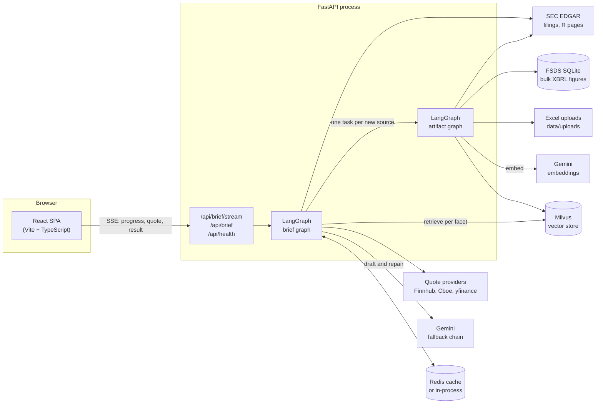
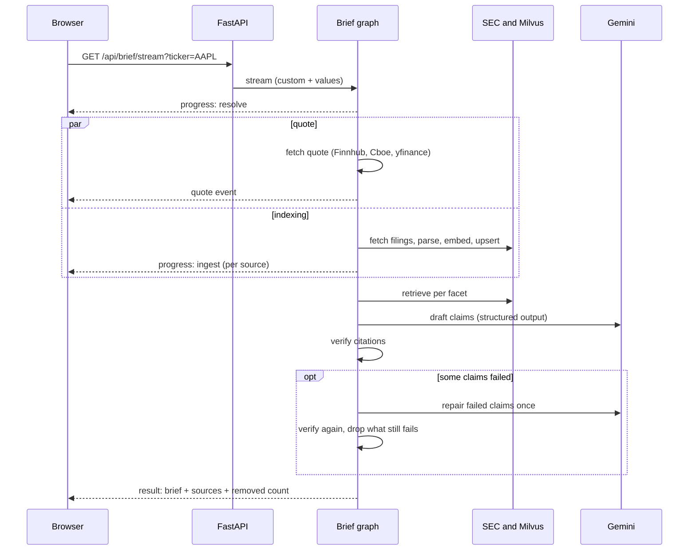

# Stock Briefing

An advisor types a ticker and gets a **delayed quote** plus a **summary of the company's latest SEC filings in which every claim cites its source**. Each claim carries a verbatim quote and a link. Claims whose quotes can't be found in the cited filing or spreadsheet row are retried once and then dropped, and the screen says how many were removed.

> **Status:** a working demo that runs locally with one API key (Gemini). It is not production software: there is no authentication, and quotes come from unofficial delayed feeds. See [Limits and roadmap](#limits-and-roadmap).

**Contents:** [The idea](#the-idea) · [What the advisor sees](#what-the-advisor-sees) · [Architecture](#architecture) · [Tech stack](#tech-stack) · [How trust works](#how-trust-works-citations-and-verification) · [Improvements by stakeholder](#improvements-by-stakeholder) · [Data sources](#data-sources-and-freshness) · [Design decisions](#design-decisions-and-trade-offs) · [Run it](#run-it-locally) · [Configuration](#configuration) · [Evaluation and tests](#evaluation-and-tests) · [Limits and roadmap](#limits-and-roadmap) · [Troubleshooting](#troubleshooting) · [Repository layout](#repository-layout)

---

## The idea

**The problem.** Before a client conversation, a wealth-management advisor wants to know where a company stands: its price, and what its latest 10-K, 10-Q and 8-Ks say about results, risks, liquidity and outlook. Reading the filings takes an hour. Asking a general chatbot takes a minute but gives an answer the advisor can't safely repeat, because nothing shows where each statement came from, and language models do invent figures.

**The approach.** Use the model for what it is good at (reading and condensing text) and take everything else out of its hands:

| Principle | How it is enforced |
|---|---|
| **No claim without a source** | The model must return each claim with source aliases and a verbatim quote. A claim with no citation is rejected. |
| **Sources are checked by code, not trusted** | A verifier looks up every quote in the stored source text, or every number in the cited spreadsheet row. Failures are retried once, then dropped, and the count is shown. |
| **Figures never come from the model** | Statement numbers come from SEC XBRL data or the advisor's own Excel files, kept exact (never rounded or converted). The model may only copy them. |
| **The model can't invent a link** | It cites `S1`, `S2`, …. Code maps those aliases to real filings, items and rows. |
| **Say what is missing** | Failed sources, a missing quote, a stale data set and removed claims all appear on screen as warnings. Nothing fails silently. |
| **Reports facts, not advice** | The prompt forbids interpretation, prediction and recommendations. The footer says "Not investment advice". |

**Scope, as decided.**

- Audience is advisors only. Quotes may be about 15 minutes delayed.
- US SEC registrants with a ticker. ETFs and foreign issuers are out of scope.
- Sources: the latest 10-K, the latest 10-Q, up to 4 8-Ks from the last 120 days, plus optional `.xlsx` files the advisor drops in `data/uploads/<TICKER>/`.
- Runs locally. It is meant to be pushed to GitHub later, so it must be clone-and-run: no secrets in the repo, and optional services behind flags.

---

## What the advisor sees

1. Type `AAPL` (or click an example chip) and press **Brief me**.
2. A progress list tracks seven stages: find company, fetch quote, index new filings, retrieve evidence, draft cited claims, verify citations, assemble brief.
3. The **quote card** appears as soon as the quote arrives, usually before the summary.
4. The brief appears in seven sections: business overview, financial performance, liquidity & capital, key risks, trends & outlook, recent events (8-K), legal proceedings.
5. Each claim ends with numbered chips. Click one to see the verbatim quote and a link to the filing on sec.gov (or the spreadsheet file, sheet and row).
6. A banner says how many claims passed verification and how many were removed. Warnings appear above the brief. **Rebuild** re-indexes and ignores the cache.

The first lookup of a ticker indexes its filings, which takes minutes on Gemini's free tier. After that, a repeat lookup is instant and the quote is still fetched fresh.

---

## Architecture

### System view



Redis is only a hot cache (quotes, the filing index, finished briefs). The durable evidence lives in Milvus, so losing Redis costs a recompute, never data.

### The brief graph (LangGraph)

```
START ─▶ resolve ─┬─▶ fetch_quote ───────────────────────────────▶ END   (delayed quote, Redis 60s)
                  └─▶ plan_ingest ─ Send per new source ─▶ worker ─┐
                                   └─ nothing new ────────────────┴─▶ retrieve
retrieve ─▶ summarize ─▶ verify ─┬─ failures, first try ─▶ repair ─▶ verify
                                 └─────────────────────────────▶ finalize ─▶ END
```

| Node | What it does |
|---|---|
| `resolve` | Ticker to company (SEC `company_tickers.json`), pick filings, scan uploads, compute the cache key. A cache hit short-circuits indexing. |
| `fetch_quote` | Runs **in parallel** with indexing. Tries providers in order, caches 60 s. A failure becomes a warning and never stops the brief. |
| `plan_ingest` | Decides what is new. Skips anything already in Milvus (by accession and origin) unless `refresh` is set. |
| `worker` | Fan-out via `Send`: one task per new source, each running the artifact graph. One bad source is recorded and reported, and the others continue. |
| `retrieve` | Facet-based filtered vector search (see below). Gives sources short aliases `S1..Sn`. |
| `summarize` | Gemini with structured output: a list of claims, each with a facet, text and citations (alias + verbatim quote). |
| `verify` | Code checks every citation against the stored source (see [How trust works](#how-trust-works-citations-and-verification)). |
| `repair` | Re-prompts **only the failed claims**, once, with the reasons they failed. |
| `finalize` | Keeps verified claims, numbers the references, builds sections, sources and metadata, and caches the brief unless indexing was incomplete. |

### The artifact graph (per-source worker)

```
route ─┬─ html filing / 8-K exhibit ─▶ parse_html ─────────▶ passages (Item-aware)
       ├─ FSDS database ────────────▶ parse_fsds ─┬────────▶ statement rows
       │                                          └─ empty ─▶ parse_statements (SEC R pages)
       ├─ SEC R pages ──────────────▶ parse_statements ────▶ statement rows
       ├─ .xlsx upload ─────────────▶ parse_xlsx ──────────▶ sheet rows (Excel row numbers)
       └─ .pdf upload ──────────────▶ parse_pdf ───────────▶ skipped with a warning (Phase 2)
                                                      all ─▶ index: embed (Gemini) ─▶ Milvus upsert
```

The routing edge is where parser choice lives. Adding a new source type (for example PDF or a transcript) means adding one parser and one branch.

### Evidence model

Everything retrievable is a `Record`, either a document **passage** or a spreadsheet-style **row**:

- **Passages** come from filing HTML. The parser strips hidden XBRL, keeps data tables whole, segments by Item headings (the table-of-contents copy loses to the real section), and cuts about 700 tokens per passage. Kept sections: 10-K Items 1, 1A, 3, 7, 7A; 10-Q Part I Items 2 and 3 plus Part II Items 1 and 1A; 8-K items (except 9.01) and EX-99 exhibits.
- **Rows** come from FSDS, SEC R pages, or an Excel upload. They carry `cells` (column heading to value), which is what numeric verification compares against.
- Each record is embedded with a deterministic context header (`TICKER | form | filed date | Item`) so a passage still means something out of context. This is the cheap form of contextual retrieval.

### Facet-based retrieval

The brief has seven fixed facets. Each runs one or more **filtered** vector searches, always scoped to this ticker and the selected accessions, and often to specific sections or to rows only:

| Facet | Evidence |
|---|---|
| Business overview | 10-K Item 1 |
| Financial performance | MD&A passages (10-K Item 7, 10-Q Part I Item 2) + statement rows |
| Liquidity & capital | MD&A passages + balance sheet and cash flow rows |
| Key risks | 10-K Item 1A, 10-Q Part II Item 1A |
| Trends & outlook | MD&A + 8-K EX-99 exhibits |
| Recent events | 8-K filings |
| Legal proceedings | 10-K Item 3, 10-Q Part II Item 1 |

The summarizer sees only these passages and rows, so it can't cite what it was never given. Filter values are validated against a strict character whitelist before they enter a Milvus expression.

### Request lifecycle (cold lookup)



A second request for the same ticker waits behind a per-ticker lock and then hits the warm caches.

---

## Tech stack

| Layer | Choice | Why |
|---|---|---|
| Orchestration | **LangGraph / LangChain** | The pipeline has real branching: parallel quote and indexing, fan-out per source, a bounded repair loop. Graph nodes map one-to-one to the progress stages the UI shows. |
| LLM | **Gemini** (`gemini-flash-latest`, with a fallback chain) via `langchain-google-genai` | The one key available. Structured output gives a typed list of claims. |
| Embeddings | **`gemini-embedding-001`**, 768 dimensions, behind an `Embedder` interface | Provider is config. Model name and dimension are part of the Milvus collection name, so switching models never mixes incompatible vectors. |
| Vector store | **Milvus** (Milvus Lite embedded by default; `MILVUS_URI` for a server) | Filtered search (`ticker`, `accession`, `section_key`, `source_type`, `form`) is central to the design. Lite means no Docker is needed. |
| Cache | **Redis**, with an in-process fallback | Hot cache only. Optional. |
| Bulk figures | **SQLite** built from the SEC Financial Statement Data Sets | Exact "as filed" XBRL numbers with no network. Cuts SEC requests (JPMorgan: 25 to 13 per cold brief). |
| Filings | **SEC EDGAR** over `httpx`, parsed with BeautifulSoup + lxml | Free, official, immutable. |
| Excel | **openpyxl** (cached values; formulas are never run) | Row numbers match what Excel shows. |
| Quotes | Finnhub, Cboe delayed JSON, yfinance (tried in order) | Finnhub is the recommended source once you have a free key. The other two are keyless but unofficial. |
| API | **FastAPI** + Server-Sent Events | Streams progress as the graph runs. A blocking `/api/brief` also exists. |
| Frontend | **React 19, TypeScript, Vite** | Single-page app. Served by FastAPI from `frontend/dist` after `make build`, or by the Vite dev server with hot reload. |
| Observability | **LangSmith** (optional) | Each run is tagged with ticker, models and prompt version. |
| Tests | **pytest**, fakeredis, hand-written fakes | 101 offline tests; no network and no keys. |
| Packaging | `pyproject.toml` (hatchling), `Makefile`, `docker-compose.yml` (Redis only) | |

---

## How trust works: citations and verification

### What a citation looks like

| Source | Cited as | Verified by |
|---|---|---|
| 10-K / 10-Q / 8-K text (Items 1, 1A, 3, 7, 7A; 10-Q MD&A, risk factors; 8-K items and EX-99.1) | form · Item · filing date, linked to the filing on sec.gov | the quote must appear in the cited passage |
| Statement figures from the **SEC Financial Statement Data Sets** (income statement, balance sheet, cash flows) | form · statement (R-file) · line N: *the filer's line label* | every number in the quote must equal a cell in that row |
| Statement figures from the filing's **SEC R pages** (fallback when the data sets lack the filing) | form · statement (R-file) · row N | same |
| `.xlsx` files dropped in `data/uploads/<TICKER>/` | file · sheet · row N (the row number Excel shows) | same |

### The verification gate (`briefing/verify.py`)

- **Document quotes.** Text is normalised before comparing (Unicode NFKC, curly quotes and dashes, whitespace, case). Every fragment of 12 or more characters must appear in the cited passage, and the longest fragment must be at least 20 characters. Short quotes are rejected because they prove nothing. Ellipses (`…`) let a quote skip text while each piece is still checked.
- **Figures.** Every number in the quote must equal a cell in the cited row. No unit conversions are accepted. Numbers that merely restate the row's label or column headings (a year such as "2026") don't count as claims. A quote with no figure from the row fails.
- **Aliases.** A citation to an alias that wasn't provided fails.
- **Outcome.** Failed claims go back to the model once with the reasons. Whatever still fails is dropped, and `removed_claims` is shown on screen.

### What verification proves, and what it does not

It proves the quoted text or number **exists in the cited source**. It does **not** prove the claim is entailed by the quote. Treat the brief as a fast, well-sourced starting point and click through for anything that matters. An entailment check is on the roadmap.

### Notes on FSDS figures

Values are shown in millions or thousands only when that is exact (never rounded). The SEC rounds period ends to month end in this data set, so columns say "3 months ended Jun 2026", not a day. FSDS `line` is the data set's presentation order, not the rendered R-page row, so the citation names the R-file, the line number and the filer's own label.

---

## Improvements by stakeholder

Each row is a concern a stakeholder would raise and what was built for it. File names point at the code.

### Advisors (the users)

| Concern | What was built | Where |
|---|---|---|
| "I can't repeat a statement I can't trace." | Numbered citation chips expand to the verbatim quote and a link to the filing or Excel row. | `BriefView.tsx`, `models.Record.citation_label` |
| "I don't want to stare at a spinner." | Live progress over SSE for seven stages. The quote shows as soon as it arrives, in parallel with indexing. | `events.py`, `useBrief.ts`, `Progress.tsx` |
| "The quote shouldn't depend on the summary working." | The quote branch is independent. If every provider fails, the brief still builds with a warning. | `graphs/brief.py` `fetch_quote` |
| "Repeat lookups before a meeting should be instant." | Finished briefs are cached 24 hours, keyed on the filing set, models and prompt version. `make prewarm` pays the indexing cost ahead of a demo. | `graphs/brief.py`, `scripts/prewarm.py` |
| "My own model is more current than the filings." | Drop an `.xlsx` in `data/uploads/<TICKER>/` and it is indexed and cited by file, sheet and the row number Excel shows. | `parsing/xlsx_upload.py` |
| "Tell me what you couldn't do." | Warnings for missing filings, failed sources, an unavailable quote or an overloaded model. An error screen with a plain-English cause, not a stack trace. | `events.short_error`, `run.friendly_error` |
| "Is this accessible?" | Labelled inputs, `aria-expanded` on citation chips, `role="alert"` on errors, screen-reader text on external links. | `App.tsx`, `BriefView.tsx` |

### Compliance and risk

| Concern | What was built | Where |
|---|---|---|
| Invented sources or links | The model cites aliases only. Code resolves them to real filings, items and rows. | `facets.Retriever`, `graphs/brief.finalize` |
| Invented or altered numbers | Figures come from XBRL or Excel, exact and unrounded. A quoted number must equal a cell in the cited row. | `parsing/fsds_rows.py`, `verify.py` |
| Unverified claims reaching the screen | Verification gate, one repair pass, then removal. The removed count is shown. A brief with no surviving claims says so rather than showing nothing. | `verify.py`, `graphs/brief.py` |
| Advice or speculation | The prompt forbids interpretation, prediction and recommendations. The footer says "Not investment advice". | `llm.SYSTEM`, `App.tsx` |
| Audit and reproducibility | The cache key includes accession numbers, model, embedding and prompt version. Each brief records the model used, retries, first-pass failures, evidence count and figure sources. LangSmith traces are tagged by ticker and model. | `graphs/brief.resolve`, `graphs/brief.run_config` |
| Honesty about limits | The README, the code docstring and the footer all state that verification does not prove entailment, and that quotes are delayed and unofficial. | this file |
| Secrets in the repo | `.env` is git-ignored. `.env.example` holds placeholders. The SEC contact comes from the environment. | `.gitignore`, `.env.example` |

### Engineering and IT

| Concern | What was built | Where |
|---|---|---|
| "Can I run it in five minutes?" | One key (Gemini) is enough. Milvus Lite is embedded, Redis is optional, and `LLM_PROVIDER=offline` runs an extractive stand-in with no LLM. | `config.py`, `llm.OfflineSummarizer` |
| Vendor lock-in | LLM, embeddings, quote providers and the figure source are config switches behind small interfaces. Model name and dimension are recorded in the Milvus collection name. | `embeddings.py`, `llm.py`, `sources/quotes.py` |
| Model overload and quota errors | Fallback chain: 503 is retried briefly then moves on, 429 and 404 skip straight to the next model, and a genuine bug (a 400) is raised rather than hidden. | `llm.GeminiSummarizer` |
| Embedding quota | A sliding-window limiter paces to `EMBEDDING_RPM`, honours the provider's "retry in N s" hint, and tells the UI why it is waiting. | `embeddings.RateLimiter`, `Embedder._retry` |
| One bad filing sinking the brief | Per-source error capture. A brief built while a source failed is flagged and **not cached**, so the next lookup retries. | `graphs/brief.worker`, `finalize` |
| SEC fair-access rules | A global request limiter (about 8 requests/s, under the SEC's 10), retries with backoff, a descriptive User-Agent that must contain an email, filings cached on disk forever (they are immutable), and bulk figures from a local database. | `sources/edgar.py`, `sources/fsds.py` |
| Milvus connection hiccups | A released or unloaded collection is reloaded and the call retried once. | `store.VectorStore._call` |
| Incremental work | Already-indexed filings are skipped. Only new accessions are fetched, parsed and embedded. | `graphs/brief.plan_ingest` |
| Confidence in changes | 101 offline tests with fakes. The graph, API, parsers, verification, pacing and fallbacks are all covered. | `tests/` |
| Operability | `/api/health` reports missing configuration, backend, evidence row count and FSDS coverage. The UI shows a "Setup needed" banner from it. | `api.py` |

### Data and model quality owners

| Concern | What was built | Where |
|---|---|---|
| "How do we know the model is right?" | A 15-question **golden set** about Apple's filings, scored by rules, not by another LLM. It is lenient about format (`2026-01-30` or "January 30, 2026"; `143,756,000,000` or "$143.756 billion") and strict about substance (period, sign, label, abstaining when the files can't answer). | `golden.py`, `tests/golden/sec-golden.jsonl` |
| "Can it gate a deploy?" | `scripts/eval_golden.py` exits non-zero below `--min-pass` (default 100%). `--dry-run` proves the model would be *given* the evidence without spending anything. `--show-pack` prints exactly what it sees. | `scripts/eval_golden.py` |
| Bulk-data corruption | FSDS ingest runs in one transaction per quarter and is idempotent (re-running replaces the quarter). It repairs rows split by a stray tab inside `segments`, and counts and reports rejected rows. | `sources/fsds.ingest_quarter` |
| Consolidated vs segment figures | The reader returns only consolidated values (empty `segments` and `coreg`), excludes parenthetical lines, and handles amendments as separate row sets. | `sources/fsds.FsdsStore.statement` |
| Stale bulk data | If the data sets lack a filing, the app falls back to scraping the filing's SEC R pages. `/api/health` reports what the loaded data covers. | `graphs/brief.plan_ingest`, `graphs/artifact.after_fsds` |

### Leadership and budget

| Concern | What was built |
|---|---|
| Cost | Runs on free tiers. Work is incremental and cached at four levels: filings on disk, vectors in Milvus, finished briefs for 24 hours, quotes for 60 seconds. A preflight (`make check`) costs a fraction of a cent. |
| Reputational risk | Unverified claims are dropped rather than shown. Limits are stated up front and not buried. |
| Clarity of what is next | A written roadmap and a list of what was **not** tested (Azure and OpenAI paths, PDF parsing, retrieval quality). |

---

## Data sources and freshness

| Source | Used for | Freshness | Notes |
|---|---|---|---|
| EDGAR submissions API | Choosing filings | Cached 1 hour | Latest 10-K, latest 10-Q, up to 4 8-Ks within 120 days |
| EDGAR filing HTML and EX-99 exhibits | Passages | Immutable; disk-cached | Born-digital inline-XBRL HTML, so no OCR |
| **SEC Financial Statement Data Sets** (SQLite) | Statement figures | Lags: loaded quarters only | Preferred when it has the filing |
| EDGAR R pages | Statement figures (fallback) | Live | Used when FSDS lacks the filing |
| `.xlsx` uploads | Figures from the advisor's own model | As uploaded | Max 10 MB, 2,000 rows per sheet, cached values only |
| Quote providers | Delayed quote | 60 s cache | Finnhub, Cboe (unofficial), yfinance (unofficial) |

EDGAR's `Financial_Report.xlsx` is **not** used: it returns 404 for new filings, so it can't be relied on.

**Freshness gap.** The data sets lag. With 2026 Q1 to Q3 loaded (17,011 filings, filed 2026-01-02 to 2026-09-30), a company's newest filing after 30 September comes from R pages instead, and so does Apple's 10-K filed 2025-10-31. Load the next quarter when the SEC publishes it.

### Loading the SEC Financial Statement Data Sets

Quarterly zips from <https://www.sec.gov/dera/data/financial-statement-data-sets> hold the primary-statement numbers of every XBRL filing. Unzip each quarter into its own folder and load them into SQLite:

```bash
mkdir -p data/raw/2026q1 && unzip 2026q1.zip -d data/raw/2026q1   # repeat per quarter
python scripts/ingest_fsds.py                                      # writes data/fsds.sqlite
```

- The app uses the database **automatically when `data/fsds.sqlite` exists** and falls back to R pages for any filing it lacks (or when the file is absent), so the repo runs without the 2 to 3 GB of data.
- Only 10-K, 10-Q and amendments are loaded (`--forms` to change). `data/raw/` and the SQLite file are git-ignored.
- Ticker to CIK uses SEC's `company_tickers.json` (the app caches it); the database's own `tickers` table is only filled if you pass `--tickers`.

---

## Design decisions and trade-offs

| Decision | Chosen | Alternative (not chosen) | Why |
|---|---|---|---|
| Where figures come from | XBRL data sets and Excel, copied verbatim | Let the model read tables | A model reading a table can transpose or round. The data sets are exact and checkable cell for cell. |
| Citation granularity | Section level (form, Item, date) for text; line or row for figures | Sentence-level offsets | Advisors verify by opening the filing. Section level is checkable and honest. |
| Verification | Deterministic substring and cell equality | A second LLM as judge | Cheap, repeatable, and can't be talked out of a failure. Entailment is deferred. |
| On failure | Retry failed claims once, then drop | Show with a warning | An unverified claim on an advisor's screen is worse than a gap. |
| Vector store | Milvus Lite by default, server by config | A hosted vector DB | No Docker or account needed for a demo, and the same code runs against a standalone server. |
| Embedding dimension | 768, recorded in the collection name | Fixed 3072 | Smaller and faster. Naming the collection by model and dimension prevents mixing vectors. |
| Quote feeds | A provider chain, with unofficial feeds labelled | One paid feed | Free for a demo. Every quote shows its source and as-of time. Swap in a licensed feed for production. |
| Caching | Redis for hot data, Milvus for durable evidence | Redis for everything | Losing Redis must never lose evidence. |
| FSDS vs R pages | FSDS first, R pages as fallback | R pages only | Saves SEC requests and gives consistent multi-period columns, with graceful fallback. |
| Concurrency | One run per ticker at a time | Fully parallel | The second request hits warm caches instead of duplicating work and quota. |
| Failed model | Ordered fallback chain | Fail the request | Free-tier models return 503 or 429 often enough that a single model is not usable. |

---

## Run it locally

Prerequisites: Python 3.10+, Node 20+, a [Gemini API key](https://aistudio.google.com/apikey), and the SEC's requirement of a descriptive `User-Agent` with your contact email.

```bash
make setup                      # venv + deps + npm install   (or: uv venv; uv pip install -e ".[dev]"; cd frontend && npm install)
cp .env.example .env            # then set SEC_USER_AGENT and GOOGLE_API_KEY
make check                      # preflight: embeddings + structured Gemini output (costs a fraction of a cent)
make build && make api          # SPA + API on http://localhost:8000
```

Hot-reload frontend instead: `make api` in one terminal, `make web` in another, open <http://localhost:5173>.

Redis is optional (`docker compose up -d redis` or `brew services start redis`). Without it the API uses an in-process cache. Milvus runs embedded (Milvus Lite, file `data/milvus.db`). To use a server, set `MILVUS_URI=http://host:19530`. **Leave `MILVUS_URI` empty unless a server is actually running**; the API reports a clear error otherwise.

First lookup of a ticker indexes its filings. `make prewarm T="AAPL MSFT JPM"` does that ahead of a demo; briefs then stay cached for 24 hours.

### Free-tier realities (measured while building this)

- Gemini **embeddings** are capped at **100 texts per minute and 1,000 per day** on the free tier, counted per text. A cold ticker costs roughly 300 (Apple) to 600 (JPMorgan, with several earnings supplements), so the free tier covers about **two or three new tickers a day**. The embedder paces itself (80/min, leaving headroom), honours the provider's retry delay, and when the *daily* cap is hit it stops at once with "resets in ~Nh" instead of waiting. Already-indexed tickers cost nothing: the facet query vectors are cached on disk and finished briefs stay in Redis for 24 hours. A paid key with `EMBEDDING_RPM=0` removes all of this.
- Spend the daily budget deliberately: `make prewarm T="AAPL MSFT"` before a demo, then show those tickers.
- Gemini **models** return 503 under load and some return 429 on free keys. The summarizer retries briefly, tries the fallback chain, and finally says plainly that Gemini is busy. The filings stay indexed, so the retry is fast. Run `make check` to see which models your key can actually use.
- A brief built while any filing failed to index is flagged and **not cached**, so the next lookup retries it.

---

## Configuration

Everything is in `.env` (see `.env.example`). The ones you will touch:

| Variable | Default | Notes |
|---|---|---|
| `SEC_USER_AGENT` | – | required; must contain an email |
| `GOOGLE_API_KEY` | – | required unless `LLM_PROVIDER=offline` (`GEMINI_API_KEY` is accepted as an alias) |
| `LLM_MODEL`, `LLM_FALLBACK_MODELS` | `gemini-flash-latest`, `gemini-3.6-flash,gemini-flash-lite-latest` | tried in order on overload (503), quota (429) or retirement (404) |
| `EMBEDDING_RPM` | `80` | texts/minute; Gemini's free tier is 100. Use `0` on a paid tier |
| `MILVUS_URI` | empty → `data/milvus.db` | |
| `REDIS_URL` | `redis://localhost:6379/0` | optional; falls back to in-process |
| `USE_FSDS`, `FSDS_PATH` | `true`, `data/fsds.sqlite` | `USE_FSDS=false` forces R-page scraping |
| `QUOTE_PROVIDERS` | `finnhub,cboe,yfinance` | finnhub needs `FINNHUB_API_KEY`; the others are keyless but **unofficial and demo-grade** |
| `LANGSMITH_TRACING`, `LANGSMITH_API_KEY` | off | each run is tagged with ticker, models and prompt version |

Less common (environment variables with these names): `BRIEF_CACHE_TTL` (86400 s), `QUOTE_CACHE_TTL` (60 s), `FACET_TOP_K`, `MAX_8K` (4), `FILINGS_LOOKBACK_DAYS_8K` (120), `CORS_ORIGINS`.

Provider choice is config, not code: `EMBEDDINGS_PROVIDER=openai` (needs `pip install langchain-openai`; untested here) or `fake`, and `LLM_PROVIDER=offline` runs an extractive stand-in with no LLM, useful for trying the UI without a key.

---

## Evaluation and tests

### Unit and integration tests

```bash
make test        # 101 offline tests: parsers, verification, graphs, API, FSDS, golden scoring, pacing, fallbacks
```

They use fakes (`tests/fakes.py`) and fakeredis, so they need no network and no keys. Last run: 101 passed.

### Golden-set evaluation

```bash
python scripts/eval_golden.py --dry-run          # no model call: only checks the model would be GIVEN the evidence
python scripts/eval_golden.py                    # runs the 15 questions through your configured Gemini models
python scripts/eval_golden.py --only SEC-06 SEC-13
python scripts/eval_golden.py --show-pack SEC-13 # print the sources the model sees for one question
```

- Fifteen questions about Apple's fiscal Q1 to Q3 2026 filings cover filing dates, quarterly net sales, the filer's line labels, taxonomy labels, a signed change between quarters, a documentation question, and one question that **should be refused** (fiscal Q1 2028 is not in the files).
- The evidence pack is built deterministically from `data/fsds.sqlite` plus the data-set documentation PDF (via `pdftotext`), then scored by rule.
- A pass needs a correct answer **and** a citation to a source the model was actually given.
- Each run is written to `data/eval/golden-<timestamp>.json`, with the model that answered each question and which models failed first. The exit code can gate a deploy: `0` passed, `1` wrong answers, `2` not evaluated because models errored (quota 429, overload 503).
- **Current state:** `--dry-run` confirms the evidence is present for 15 of 15 questions. The first live run on 2026-11-02 passed 15 of 15, but `gemini-flash-latest` answered none of them. It returned quota (429) or overload (503) errors, so `gemini-3.6-flash` and `gemini-flash-lite-latest` answered, and some answers took about 90 s. Treat the pass rate as a property of the fallback chain, and re-run when the primary model has quota.
- **What it does not test:** Milvus retrieval over free text, and the narrative briefing itself. It checks the model and the data layer.

### Smoke scripts

```bash
SEC_USER_AGENT='You you@example.com' python scripts/smoke_real.py JPM --fsds data/fsds.sqlite   # live EDGAR, no API keys
python scripts/check_gemini.py                         # live Gemini preflight
```

---

## Limits and roadmap

**Known limits**

- Verification proves a quote exists in its source. It does not prove the claim follows from the quote.
- No authentication in front of the API. Suitable for local or trusted-network use only.
- Quotes from Cboe and yfinance are unofficial and can break without notice. Use Finnhub or a licensed feed for anything beyond a demo.
- US SEC registrants only. ETFs and foreign issuers are out of scope.
- Bulk figures lag by the data-set quarter. The R-page fallback covers newer filings.
- Retrieval quality is judged by reading briefs, not yet by a measured retrieval test.

**Not built yet**

1. PDF parsing: a local parser first, then Azure Document Intelligence as an adapter. PDFs are skipped with a visible warning today.
2. An entailment check on claims.
3. LangSmith-hosted evals for the narrative briefing (the golden questions cover only the data layer and the model).
4. Authentication in front of the API, and per-advisor audit logging.
5. A retrieval evaluation (does the right passage reach the model?).

The Azure and OpenAI paths are written behind config but untested because they need credentials not available while building.

---

## Troubleshooting

- **`ModuleNotFoundError: briefing` on macOS** with an editable install: macOS can flag the venv's `.pth` file as hidden so Python skips it. Run commands from the repo root (the Makefile does), or `chflags nohidden .venv/lib/python*/site-packages/*.pth`. Tests don't depend on it.
- **"Cannot open Milvus at http://localhost:19530"**: no server is running there. Clear `MILVUS_URI` in `.env` to use the embedded file.
- **"another process holds the lock on data/milvus.db"**: an older server is still shutting down (uvicorn waits for open streams). `pkill -9 -f "uvicorn briefing.api"`, then start again. `make api` uses a 5 s graceful-shutdown timeout to avoid this.
- **"Setup needed" banner in the UI**: `/api/health` lists exactly what is missing.
- **"Gemini could not answer right now"**: every configured model was overloaded or over quota. The filings are already indexed, so trying again in a minute is fast. Run `make check` to see which models your key can use.
- **A cold ticker is slow**: that is the embedding quota (100 texts/minute on the free tier), not a hang. Progress messages say when it is pausing.

---

## Repository layout

```
stock-briefing/
├── briefing/                    Python package
│   ├── api.py                   FastAPI app: /api/health, /api/brief, /api/brief/stream, serves the SPA
│   ├── run.py                   runs the graph, turns it into UI events, friendly errors
│   ├── services.py              builds every collaborator once (cache, EDGAR, quotes, embedder, store, LLM)
│   ├── config.py                settings from .env
│   ├── models.py                Company, Filing, Record, Artifact, Quote
│   ├── graphs/brief.py          main graph: resolve → quote ‖ ingest → retrieve → summarize → verify/repair → finalize
│   ├── graphs/artifact.py       per-source graph: route → parse → index
│   ├── facets.py                the seven facets and filtered retrieval
│   ├── llm.py                   Gemini summarizer (structured output, fallback chain) + offline stand-in
│   ├── verify.py                the citation verification gate
│   ├── embeddings.py            Embedder interface, rate limiter, Gemini/OpenAI/hashing backends
│   ├── store.py                 Milvus wrapper and filter builder
│   ├── cache.py                 Redis with in-process fallback
│   ├── events.py                progress events and readable provider errors
│   ├── golden.py                golden-set loading, evidence packs, rule-based scoring
│   ├── sources/                 edgar.py · fsds.py · quotes.py
│   └── parsing/                 html_filing.py · statements.py · fsds_rows.py · xlsx_upload.py · pdf.py (stub)
├── frontend/                    React + TypeScript + Vite (App, useBrief, BriefView, QuoteCard, Progress)
├── scripts/                     prewarm · check_gemini · smoke_real · ingest_fsds · eval_golden
├── tests/                       101 offline tests; golden/ holds the 15-question set and the data-set PDF
├── data/                        git-ignored: milvus.db, fsds.sqlite, raw/, cache/, uploads/, eval/
└── Makefile · docker-compose.yml (Redis only) · pyproject.toml · .env.example
```
